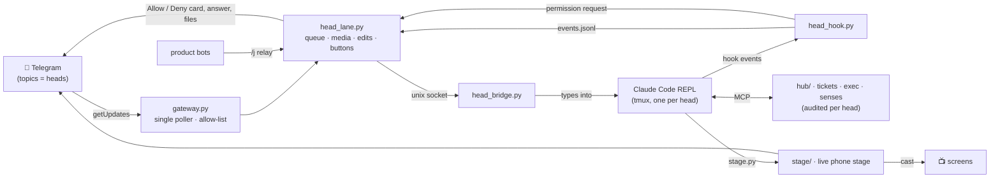

# HydraEpica

*Pocket command for a many-headed agent.*

**An operations and safety layer for running Claude Code agents unattended, driven from your phone.**

Several always-on Claude Code sessions ("heads") share one agent identity and one memory. Each head owns one
Telegram topic and one job. You talk to them from your phone, approve risky actions with a tap, watch them put
pages, pictures and video on a live phone stage (or a TV), and they hand work to each other through a shared ticket
board.

Reaching Claude Code from a phone is the easy part, and there are good tools for it. This repo is about what you
need once agents run **without you watching**:

- **They can change themselves safely.** `headsafe` snapshots a head before it edits its own code, settings or
  units, restarts it, then types a probe into its REPL. No answer within 20 s, or no `finalize` within a minute,
  and the snapshot goes back automatically and you are told.
- **Anything that gates or alerts is proven before it ships.** `ship_check` refuses a release unless the test suite
  goes red against deliberate mutants, leaves live state byte-identical, runs from the production path, the running
  process is newer than its code, and a real end-to-end proof exists. A green test suite is not enough.
- **Risky actions wait for a human.** Claude Code's permission prompts become Allow / Deny buttons on your phone.
  The hub's `exec` tool never runs destructive patterns, runs read-only commands directly, and needs a confirm for
  everything else.
- **Every action is attributed.** Each MCP call is audited to the head that made it. Every Telegram message, in and
  out, lands in one chat ledger.
- **Nothing fails silently.** Retries, fallbacks and self-heals are logged with the reason. A give-up is loud.

## How a message flows



The head's **output** is read from its own hook events (PreToolUse becomes a live status bubble,
PermissionRequest becomes an Allow / Deny card the hook waits on, Stop carries the final answer), not scraped from
the terminal. The screen is read only for login and trust prompts.

## What's in here

| Path | What it is |
|---|---|
| `harness/gateway.py` | The one process that polls the bot. Users allow-list, routing, buttons, reactions, edits. |
| `harness/head_lane.py` | One lane per head: queue, voice notes (STT), photos/albums, edits, mid-turn messages, replies. |
| `harness/head_bridge.py` | Types prompts into a Claude Code REPL in tmux; one tmux server per head. |
| `harness/hooks/head_hook.py` | Claude Code hook: every event to `events.jsonl`; permission requests wait for your tap. |
| `harness/hooks/leakcheck.py` | Demo-safe lanes: a reply or step that would show an IP, a path, a key or a name you list is held, images OCR'd. |
| `harness/hostload.py` | `/ram /vram /storage /load /loadavg` for this machine or any in `[machines]` (Linux, Mac, Windows). |
| `harness/new_lane.py` | Make a new Telegram topic and it gets its own head: folder, settings, unit, first-run dialogs. |
| `harness/jrelay.py` | `/j` to any product bot reaches that product's own head; the answer comes back in that chat. |
| `harness/tg/` | Telegram as a tool for the heads (context, search, forward, pin, buttons, progress), and `handoff.py`. |
| `harness/stage/` | The Mini App stage: cards, images, video, sandboxed HTML, galleries, live camera + push-to-talk, casting. |
| `harness/skills/` | Skills each head gets (linked in by `new_lane.py`): stage, telegram, handoff, self-edit, ship-a-gate, smaller-models. |
| `harness/render/` | Diagrams, pages and markdown to PNG; voice notes; video contact sheets. |
| `harness/llm.py` | Quick replies outside any head: local OpenAI-compatible endpoint first, hosted router as fallback. |
| `hub/` | Example MCP server: `tickets`, `exec`, `senses`, with a per-head audit log. |
| `safety/headsafe.py` | Self-edit snapshot, liveness probe, finalize-or-revert. |
| `safety/ship_check.py` | The release gate for anything that catches, surfaces or gates. |
| `deploy/` | systemd user units and an MCP config template. |

See [docs/failure-design.md](docs/failure-design.md) for why each safety piece exists and where it stops.

## Set up

Linux with systemd user services, Python 3.12, tmux, ffmpeg, and Claude Code installed and logged in.

```bash
git clone <this repo> ~/harness && cd ~/harness
python3 -m venv .venv && .venv/bin/pip install -r requirements.txt
mkdir -p ~/.config/harness && cp config.example.toml ~/.config/harness/config.toml   # edit: your Telegram id, names
echo 'HARNESS_BOT_TOKEN=<token from @BotFather>' > ~/.config/harness/secrets.env && chmod 600 ~/.config/harness/secrets.env
mkdir -p ~/heads/main/.claude && cp harness/templates/head_settings.json ~/heads/main/.claude/settings.json
sed 's/{agent}/Atlas/' harness/templates/head_instructions.md > ~/heads/main/CLAUDE.md   # your agent's name
python3 -c 'import sys; sys.path.insert(0, "harness"); import new_lane; new_lane.link_skills(sys.argv[1])' ~/heads/main
cp deploy/*.service ~/.config/systemd/user/ && systemctl --user daemon-reload
systemctl --user enable --now harness-gateway harness-stage harness-head@main
```

Turn on topics in your private chat with the bot. Each topic you create gets its own head. For the phone stage,
put an HTTPS reverse proxy in front of `~/.local/state/harness/stage.sock` and set it as the bot's Mini App URL;
keep `/api/push*` reachable from the host only.

## Tests

```bash
.venv/bin/python -m pytest tests/          # 565 tests; every one runs against a throwaway config and state dir
node tests/test_browser_page.js            # the stage page's logic against the real index.html
python3 safety/test_ship_check.py          # ship_check's own suite
```

The router suite refuses, at the socket level, to connect to a live head. That rule was earned the hard way.

## Status

Extracted from a personal lab where it has run daily since October 2026: about thirty heads across product and
infrastructure work, on one home server. The design notes in the code keep their dates and the incidents that
shaped them.

## License

Apache License 2.0. See [LICENSE](LICENSE).
